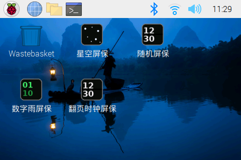
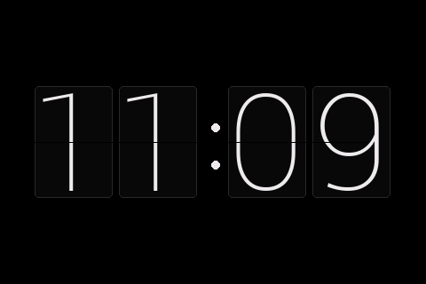

# WB Screensaver

一套运行在 **Raspberry Pi 3B + 3.5 寸 SPI 触摸屏（480×320）** 上的轻量屏保，基于 X11 + pygame。

桌面空闲 60 秒后自动进入屏保，点击/触摸屏幕或按 Esc 退出。提供三种效果，也可用桌面图标手动触发。

## 效果预览




| 屏保 | 说明 |
|---|---|
| 翻页时钟（Fliqlo 风格） | 黑底细白字、翻页动画、中央分割线与冒号，数字自动走时 |
| 数字雨（Matrix） | 绿色字符流下落 |
| 星空（Stars） | 缓慢漂移的星点 |

## 功能特性

- **空闲自动触发**：X11 空闲 60 秒后启动（用 `xprintidle` 计时）
- **点击退出**：窗口有 2 秒启动宽限期，避免触摸残留事件导致秒退
- **多屏保共存**：桌面图标可手动进入任意一种，或随机一种；切换时自动结束旧实例
- **低占用**：仅在换字/翻页时重绘，静态约 5% CPU，适合 Pi 3B 长期运行
- **开机自启**：通过 LXDE autostart 自动运行守护进程
- **无外部编译依赖**：纯 Python + pygame，无需编译 SDL

## 环境要求

- Raspberry Pi OS（Debian 12 bookworm，32/64 位均可），带 X11 桌面（LXDE/Openbox）
- Python 3 + pygame 2.x
- 系统工具：`xprintidle`、`xdotool`（安装见下）
- 屏幕：480×320 SPI 屏（如 ILI9486 / `dtoverlay=mhs35`），触摸映射为鼠标事件

```bash
sudo apt-get update
sudo apt-get install -y python3-pygame xprintidle xdotool
```

## 安装

在树莓派上执行：

```bash
git clone git@github.com:evan24255-ui/wb-screensaver.git
cd wb-screensaver
python3 make_icons.py   # 生成 icons/ 下的图标资源
bash install.sh         # 写入 LXDE 自启动项 + 桌面图标
```

`install.sh` 会做两件事：

1. 在 `~/.config/autostart/` 写入 `wb-flipclock-screensaver.desktop`，登录后自动启动守护进程；
2. 在 `~/Desktop/` 创建四个启动图标：翻页时钟、数字雨、星空、随机。

立即生效（无需重启）：

```bash
nohup bash ~/wb-screensaver/start.sh >/dev/null 2>&1 &
```

## 使用

- **自动**：桌面 1 分钟无操作 → 进入默认屏保（翻页时钟）；点一下屏幕退出。
- **手动**：双击桌面上的屏保图标直接进入对应效果；点击屏幕或按 Esc 退出。

## 配置

通过环境变量调整（在 `start.sh` 或 autostart 的 `.desktop` 里设置）：

| 变量 | 默认值 | 说明 |
|---|---|---|
| `WB_IDLE_MS` | `60000` | 空闲触发阈值（毫秒） |
| `WB_IDLE_SAVER` | `flip` | 自动触发时使用哪个屏保：`flip` / `matrix` / `stars` |
| `WB_FONT` | Quicksand Medium | 时钟字体文件路径（如 `/usr/share/fonts/truetype/dejavu/DejaVuSans.ttf`） |
| `WB_DEBUG` | 空 | 设任意值开启时钟调试日志 |
| `WB_SNAP` | 空 | 设任意值时启动 3 秒后保存渲染快照到 `/tmp/wb_snap.png` |

例：改成 30 秒触发数字雨：

```bash
WB_IDLE_MS=30000 WB_IDLE_SAVER=matrix nohup bash ~/wb-screensaver/start.sh >/dev/null 2>&1 &
```

## 文件结构

```
wb-screensaver/
├── fliqlo.py        # 翻页时钟（Fliqlo 风格）
├── matrix.py        # 数字雨
├── stars.py         # 星空
├── saver-run.sh     # 统一启动器：flip|matrix|stars|random
├── idle_watch.sh    # 空闲检测守护进程
├── start.sh         # 单实例启动入口（flock 防重复）
├── install.sh       # 安装自启动项与桌面图标
├── make_icons.py    # 生成图标资源
└── icons/           # 桌面图标 PNG
```

## 实现说明

- X11 自带的 screen blanking / DPMS 会关闭 SPI 屏，因此守护进程启动时会执行 `xset s off`、`xset s noblank`、`xset -dpms` 关闭它们，由本程序接管屏幕。
- 用 `/tmp/wb-screensaver-active` 标记文件记录当前屏保进程 PID，保证同时只有一个屏保实例运行。
- 一切基于 X11（`SDL_VIDEODRIVER=x11`），不直接写 framebuffer，因此与桌面环境共存。

## License

MIT
