# WB Screensaver

一套运行在 **Raspberry Pi 3B + 3.5 寸 SPI 触摸屏（480×320）** 上的轻量屏保，基于 X11 + pygame。

桌面空闲 60 秒后自动进入屏保，点击/触摸屏幕或按 Esc 退出。提供三种效果，也可用桌面图标手动触发。

## 效果预览

| 屏保 | 说明 |
|---|---|
| 翻页时钟（Fliqlo 风格） | 复古琥珀色七段数码管、幽灵笔画、翻页动画、闪烁方形冒号，数字自动走时 |
| 天气面板（屏保模式） | 与时钟在同一屏保内轮播：日期时间 + 天气图标 + 温度 / 湿度 / 体感 / 今日高低温 / 风；白天牛皮纸、夜间黑底琥珀，可配米色纸 |
| 数字雨（Matrix） | 绿色字符流下落 |
| 星空（Stars） | 缓慢漂移的星点 |

### UI 更新记录

每次涉及界面变化的更新，都会保存一张新截图归档到 `img/`，并在此登记：

| 截图 | 更新内容 | 日期 |
|---|---|---|
|  | 四种屏保的桌面启动图标 | 2026-11-22 |
| 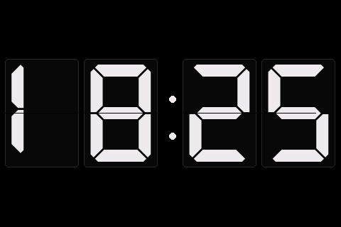 | 换用 DSEG7 Classic 七段数码管字体 | 2026-11-23 |
| 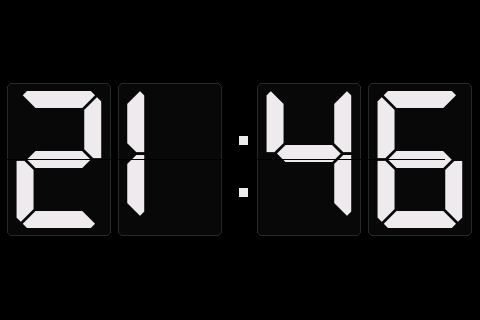 | 冒号改为方形点并每秒闪烁 | 2026-11-23 |
| 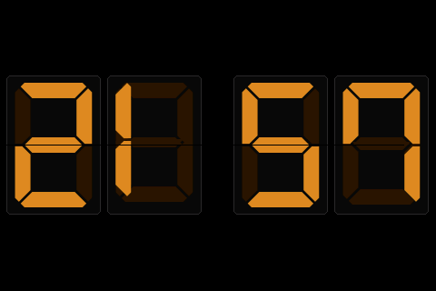 | 复古琥珀色 + 幽灵笔画 + 可调亮度 | 2026-11-23 |
| 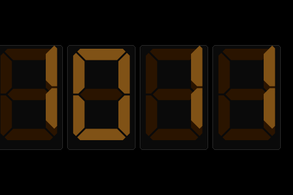 | 22:00–07:00 自动降低亮度至 50% | 2026-11-23 |
| 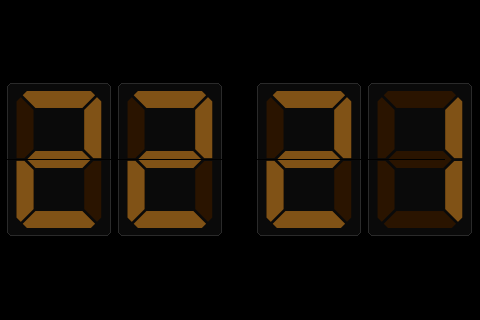 | 「1」对齐到右侧段；字形按墨迹中心校正，中缝线与中间横段对齐 | 2026-11-23 |
| 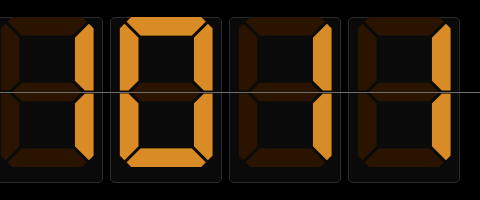 | 数字对齐细节对照（含幽灵笔画与中缝） | 2026-11-23 |
| 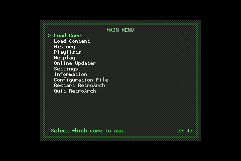 | 新增 RetroArch 复古游戏模拟器（USB 手柄操控，480×320 全屏菜单） | 2026-11-23 |
| 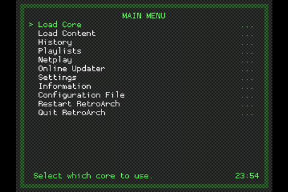 | 修复菜单启动非全屏；游戏文件收拢到 `~/work/retroarch/` 子目录，菜单启动直接全屏 | 2026-11-23 |
| 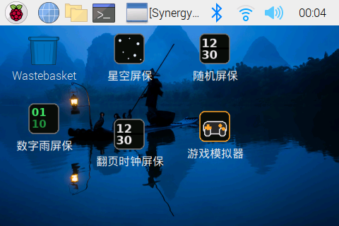 | 新增「游戏模拟器」桌面图标，双击即全屏启动（含手柄图标） | 2026-11-24 |
| 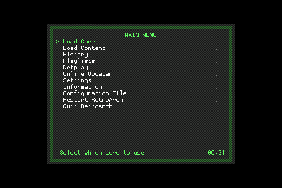 | 修复手柄方向键：D-pad 是轴（`ABS=3`）非 hat，改用 axis 映射；附按键测试器 | 2026-11-24 |
|  | 装入 Action53 54 合 1 合集 + 开源 homebrew，装 mesen 核心支持 mapper 218；修复游戏中途弹屏保的 bug | 2026-11-24 |
| 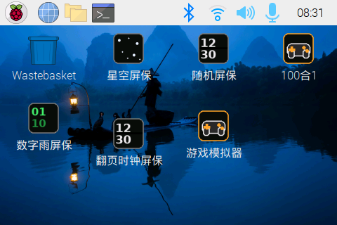 | 桌面新增「100合1」图标（双击用 Nestopia 直接进 100 合 1 合集） | 2026-11-24 |
| 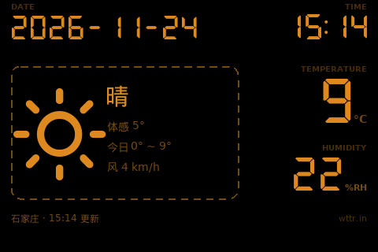 | 新增天气面板：屏保内「时钟 20 秒 ↔ 天气 12 秒」轮播，DSEG7 数字 + Weather Icons 图标 | 2026-11-24 |
| 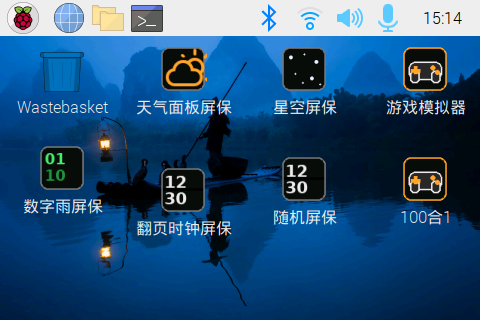 | 桌面新增「天气面板屏保」图标（单独只看天气，不轮播时钟） | 2026-11-24 |
| 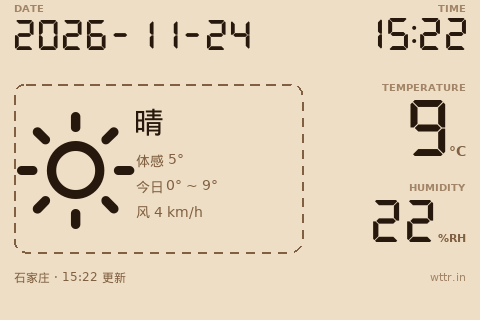 | 天气面板 `WB_WEATHER_THEME=paper` 暖纸底深字主题（还原设计稿质感） | 2026-11-24 |
| 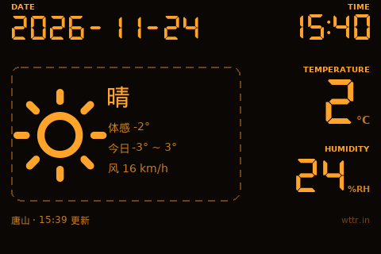 | 深色主题配色校正：底色 `#0A0704`、数字与标签回到满饱和 `#FFA42B`（原按 85% 亮度渲染导致发暗发土），虚线框改深琥珀；城市改为唐山 | 2026-11-24 |
| 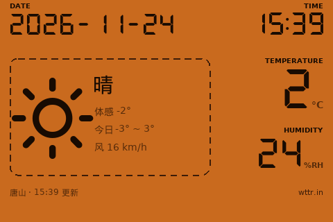 | `paper` 主题改为与设计稿一致的牛皮纸橙底 + 墨黑字；新增 `paper-light` 米色纸主题 | 2026-11-24 |
| 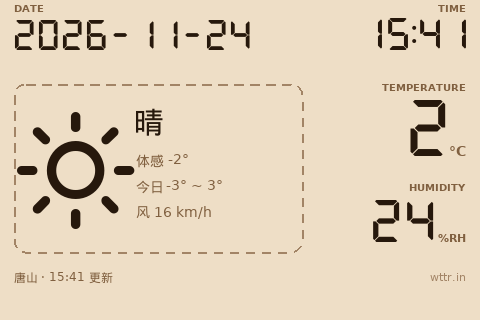 | `paper-light` 米色纸主题（浅暖底深褐字，适合白天常亮） | 2026-11-24 |
| 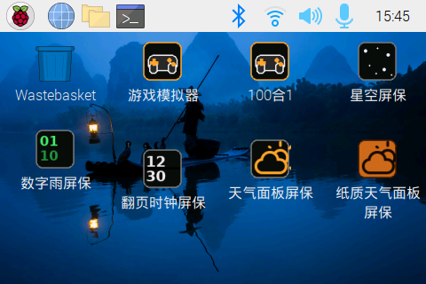 | 桌面新增「纸质天气面板屏保」图标（牛皮纸配色，一键体验 paper 主题）；`quick_exec=1` 免去执行确认弹窗 | 2026-11-24 |
| 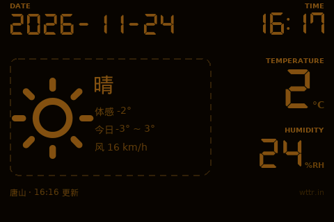 | 天气面板配色按昼夜自动切换：白天 `paper` 牛皮纸、22:00–07:00 切 `dark` 黑底琥珀并降亮，时间窗沿用夜间模式 | 2026-11-24 |
| 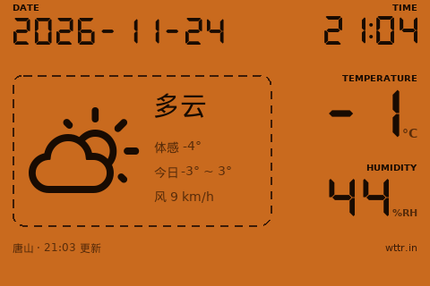 | 左侧信息块重排：图标 106→88px 并右移，最大的「多云」图标不再压左侧虚线；文字块右移 36px，图文间隔 8→16px 以上，三行明细行距 26→28px | 2026-11-24 |

> **关于游戏模拟器**：RetroArch 是独立项目，所有文件、ROM、核心、脚本、文档都在 `~/work/retroarch/`，本仓库只保留桌面图标与启动器的截图记录。游戏怎么装、怎么按键、怎么退出、怎么排错，一律看 [~/work/retroarch/README.md](../../work/retroarch/README.md)，不要在本 README 里重复。

> **维护约定**：新增或修改 UI 时，先在 Pi 上用 `WB_SNAP=1`（时钟）或截图工具保存新图，按 `img/序号-简述.png` 命名，再在上表追加一行。详见下方「截图归档」一节。本表只记屏保与桌面（480×320 屏幕）的可见变化；游戏模拟器内部的功能、按键、核心、ROM 变更不记在这里，归 `~/work/retroarch/README.md`。

## 功能特性

- **复古数码管**：DSEG7 七段字体、幽灵笔画、闪烁方形冒号；数字按字形原点对齐，「1」显示在右侧，与真实数码管一致
- **空闲自动触发**：X11 空闲 60 秒后启动（用 `xprintidle` 计时）；检测到 RetroArch 等全屏应用运行时暂停触发，避免游戏中途被屏保覆盖
- **点击退出**：窗口有 2 秒启动宽限期，避免触摸残留事件导致秒退
- **多屏保共存**：桌面图标可手动进入任意一种，或随机一种；切换时自动结束旧实例
- **低占用**：仅在换字/翻页时重绘，静态约 5% CPU，适合 Pi 3B 长期运行
- **开机自启**：通过 LXDE autostart 自动运行守护进程
- **无外部编译依赖**：纯 Python + pygame，无需编译 SDL

## 环境要求

- Raspberry Pi OS（Debian 12 bookworm，32/64 位均可），带 X11 桌面（LXDE/Openbox）
- Python 3 + pygame 2.x
- 系统工具：`xprintidle`、`xdotool`（安装见下）
- 屏幕：480×320 SPI 屏（如 ILI9486 / `dtoverlay=mhs35`），触摸映射为鼠标事件

```bash
sudo apt-get update
sudo apt-get install -y python3-pygame xprintidle xdotool
```

## 安装

在树莓派上执行：

```bash
git clone git@github.com:evan24255-ui/wb-screensaver.git
cd wb-screensaver
python3 make_icons.py   # 生成 icons/ 下的图标资源
bash install.sh         # 写入 LXDE 自启动项 + 桌面图标
```

`install.sh` 会做两件事：

1. 在 `~/.config/autostart/` 写入 `wb-flipclock-screensaver.desktop`，登录后自动启动守护进程；
2. 在 `~/Desktop/` 创建六个启动图标：翻页时钟、天气、纸质天气、数字雨、星空、随机。

立即生效（无需重启）：

```bash
nohup bash ~/wb-screensaver/start.sh >/dev/null 2>&1 &
```

## 使用

- **自动**：桌面 1 分钟无操作 → 进入默认屏保（翻页时钟，其中会轮流显示天气面板）；点一下屏幕退出。
- **手动**：双击桌面上的屏保图标直接进入对应效果；「天气面板屏保」按 `weather.conf` 的 `THEME` 出图，「纸质天气面板屏保」固定牛皮纸主题；都只显示天气、不轮播时钟；点击屏幕或按 Esc 退出。

## 配置

通过环境变量调整。注意：屏保由 LXDE autostart 启动，**不会读取 `~/.bashrc`**，因此写在该文件里的 `export` 不生效。请把变量写进 `saver-run.sh` 顶部，或在 `.desktop` 的 `Exec` 前加 `env 变量=值`：

通过环境变量调整（在 `start.sh` 或 autostart 的 `.desktop` 里设置）：

| 变量 | 默认值 | 说明 |
|---|---|---|
| `WB_IDLE_MS` | `60000` | 空闲触发阈值（毫秒） |
| `WB_IDLE_SAVER` | `flip` | 自动触发时使用哪个屏保：`flip` / `matrix` / `stars` |
| `WB_FONT` | DSEG7 Classic Bold | 时钟字体文件路径。默认 `/usr/share/fonts/truetype/dseg7-classic/dseg7-classic-latin-700-normal.ttf`（七段数码管）；原 Quicksand 字体仍作为回退 |
| `WB_COLOR` | `#FFA42B` | 数字颜色（琥珀色）。接受 `#RRGGBB` 或 `#RGB`，如 `#4AF626` 磷光绿、`#E8E8E8` 冷白 |
| `WB_BRIGHTNESS` | `85` | 白天亮度百分比 0-100，按比例缩放颜色，默认 85% 柔和不刺眼 |
| `WB_NIGHT_MODE` | `1` | 夜间模式开关，设 `0` 完全关闭 |
| `WB_NIGHT_START` | `22:00` | 夜间开始时间（24 小时制） |
| `WB_NIGHT_END` | `07:00` | 夜间结束时间，可跨午夜（如 `22:00` → `06:30`） |
| `WB_NIGHT_BRIGHTNESS` | `50` | 夜间亮度百分比，默认 50%；只影响点亮的笔画，幽灵笔画保持不变 |
| `WB_GHOST_COLOR` | `#2A1400` | 未点亮笔画的暗底色（幽灵笔画）。设 `off` / `0` 关闭 |
| `WB_AFTERGLOW` | `0` | 设 `1` 开启 CRT 余辉：熄灭的笔画渐隐而非瞬间消失 |
| `WB_AFTERGLOW_MS` | `700` | 余辉持续时间（毫秒），仅当 `WB_AFTERGLOW=1` 时有效 |
| `WB_DEBUG` | 空 | 设任意值开启时钟调试日志 |
| `WB_SNAP` | 空 | 设任意值时启动 3 秒后保存渲染快照到 `/tmp/wb_snap.png` |
| `WB_BLINK` | `1` | 设 `0` 关闭时钟冒号闪烁（常亮） |
| `WB_BLINK_MS` | `1000` | 冒号闪烁半周期（毫秒），默认 1 秒亮 / 1 秒灭 |
| `WB_WEATHER` | `1` | 设 `0` 关闭天气场景，翻页时钟只显示时钟 |
| `WB_WEATHER_ONLY` | `0` | 设 `1` 只显示天气面板（`saver-run.sh weather` 已自动设置） |
| `WB_CLOCK_SECONDS` | `20` | 轮播中时钟画面时长（秒） |
| `WB_WEATHER_SECONDS` | `12` | 轮播中天气面板时长（秒） |
| `WB_WEATHER_THEME` | 空（跟 `weather.conf`） | 钉死一套天气配色，忽略昼夜切换：`dark` / `paper` / `paper-light` |
| `THEME_DAY` / `THEME_NIGHT` | `paper` / `dark` | `weather.conf` 里的白天 / 夜间配色，时间窗沿用 `WB_NIGHT_START`–`WB_NIGHT_END` |
| `WB_WEATHER_PROXY` | 空 | 取 Open-Meteo 时用的 HTTP 代理（如 `http://192.168.5.200:7897`）；wttr.in 通常直连可用 |
| `WB_SNAP_WEATHER` | 空 | 设任意值时把天气面板存成 `/tmp/wb_snap_weather.png` |

例：改成 30 秒触发数字雨：

```bash
WB_IDLE_MS=30000 WB_IDLE_SAVER=matrix nohup bash ~/wb-screensaver/start.sh >/dev/null 2>&1 &
```

例：夜间模式改为 23:30–06:15，亮度 35%：

```bash
WB_NIGHT_START=23:30 WB_NIGHT_END=06:15 WB_NIGHT_BRIGHTNESS=35 \
  nohup bash ~/wb-screensaver/start.sh >/dev/null 2>&1 &
```

夜间模式在运行时持续检查时间，屏保跨过 22:00 / 07:00 边界会自动切换配色，无需重启。切换记录写入 `screensaver.log`。

## 天气面板（屏保模式）

翻页时钟里内置了天气场景：默认 **时钟 20 秒 → 天气 12 秒** 循环，触摸/点击依然是一次退出。画面内容是日期时间 + 当前天气图标 + 温度、湿度、体感、今日高低温、风速。

- **数据**：`wttr.in`（免 key）优先，`Open-Meteo`（免 key）备用；都取不到时回落到 `~/.cache/wb-weather.json` 的上一次结果。后台线程每 10 分钟刷新，取数不阻塞画面，断网也照常显示缓存。
- **位置**：`weather.conf`（与本文件同目录）：

```ini
# CITY 仅用于屏幕显示；取数用 LAT/LON
# 主题：白天 THEME_DAY / 夜间 THEME_NIGHT
CITY=唐山
LAT=39.63
LON=118.18
THEME_DAY=paper
THEME_NIGHT=dark
```

  删掉该文件或留空时，会用 IP 定位自动补全一次并记入日志。改城市时 `CITY` 与 `LAT`/`LON` 一起改；缓存里若还是旧城市的数据会被忽略并重新取数，不会出现「城市名换了、温度还是别处」的情况。
- **图标**：**Weather Icons**（erikflowers/weather-icons，字体 SIL OFL 1.1），随仓库附带 `fonts/weathericons-regular-webfont.ttf`，按 Unicode 码位渲染，不依赖网络、不需要额外图标文件。
- **主题**：白天一套、夜间一套，默认 `THEME_DAY=paper`、`THEME_NIGHT=dark`，到点自动换，不用重启。时间窗直接沿用夜间模式（`WB_NIGHT_START` / `WB_NIGHT_END`，默认 22:00–07:00），屏保跨过 22:00 或 07:00 时会连同配色一起切，日志里有 `weather theme -> dark|paper` 记录。三套可选配色：
  - `paper` 牛皮纸橙底 `#C96A1E` + 墨黑字，还原设计稿的纸感卡片，白天常亮看最舒服（当前白天默认）；
  - `dark` 黑底 `#0A0704` + 满饱和琥珀 `#FFA42B`，与时钟同一套颜色语言，夜里不刺眼（当前夜间默认）；
  - `paper-light` 米色纸 `#EEDEC6` + 深褐字，介于两者之间，白天也能用。
  - 只想要一套配色时把两行写成一样，或直接用 `THEME=paper`（旧的单值写法仍然有效）；`WB_WEATHER_THEME` 环境变量可以钉死一套、忽略时间切换。关掉夜间模式（`WB_NIGHT_MODE=0`）就不会切换，始终用 `THEME_DAY`。
- **亮度**：深色主题在白天按 100% 出图（不再套用时钟的 85% 柔和亮度，避免琥珀色发暗发土），夜间 22:00–07:00 才随 `WB_NIGHT_BRIGHTNESS` 降亮；两种纸主题是浅底配色，不参与夜间降亮。
- **只看天气**：双击桌面「天气面板屏保」（跟配置、会昼夜切换）或「纸质天气面板屏保」（固定 `paper`，用于白天试色），也可执行 `./saver-run.sh weather` / `./saver-run.sh weather-paper`。

## 文件结构

```
wb-screensaver/
├── fliqlo.py        # 翻页时钟（Fliqlo 风格）+ 天气场景轮播
├── weather.py       # 天气面板：取数、渲染、缓存
├── weather.conf     # 天气位置与昼夜配色（CITY / LAT / LON / THEME_DAY / THEME_NIGHT）
├── fonts/           # Weather Icons 图标字体（SIL OFL 1.1）
├── matrix.py        # 数字雨
├── stars.py         # 星空
├── saver-run.sh     # 统一启动器：flip|weather|weather-paper|matrix|stars|random
├── idle_watch.sh    # 空闲检测守护进程
├── start.sh         # 单实例启动入口（flock 防重复）
├── install.sh       # 安装自启动项与桌面图标
├── make_icons.py    # 生成图标资源
├── icons/           # 桌面图标 PNG
└── img/             # UI 更新截图归档（见下方约定）
```

## 截图归档

项目的界面变化需要留痕。每次改动 UI 时执行以下流程：

1. **保存截图**：在 Pi 上截新图。翻页时钟可用内置快照开关——启动时设 `WB_SNAP=1`，程序会在启动 3 秒后把画面写到 `/tmp/wb_snap.png`；天气面板设 `WB_SNAP_WEATHER=1` 会存到 `/tmp/wb_snap_weather.png`；其他屏保可用 `scrot` / `import -window root` 截屏。
2. **拷回并命名**：`scp pi:/tmp/wb_snap.png img/07-简述.png`，文件名用两位序号递增 + 简短英文描述（如 `07-afterglow-toggle.png`）。
3. **登记**：在「UI 更新记录」表格追加一行，包含图片链接、本次更新内容和日期。
4. **提交**：截图和 README 一起 `git add` 提交，保证图片和说明同步入库。

> 快照开关只保留在当次进程，日常运行不需要设置 `WB_SNAP`。

## 实现说明

- X11 自带的 screen blanking / DPMS 会关闭 SPI 屏，因此守护进程启动时会执行 `xset s off`、`xset s noblank`、`xset -dpms` 关闭它们，由本程序接管屏幕。
- 用 `/tmp/wb-screensaver-active` 标记文件记录当前屏保进程 PID，保证同时只有一个屏保实例运行。
- 一切基于 X11（`SDL_VIDEODRIVER=x11`），不直接写 framebuffer，因此与桌面环境共存。
- 七段字体的「1」字形原点在单元格右侧、宽度只有其他数字的 1/5。程序读取 freetype 返回的 glyph rect，把 0-9 统一绘制到同一个单元格里，因此「1」落在右侧竖段位置，而不是贴着左边。
- 夜间模式只缩放点亮笔画的颜色，幽灵笔画亮度固定；时间区间跨越午夜时按「大于等于开始，或小于结束」判断。
- 天气场景与时钟跑在同一个进程、同一个窗口里，只切换绘制分支，所以没有黑帧、没有窗口重建；天气画面按「分钟 + 数据版本 + 配色」缓存成一张 480×320 表面，静态时只做一次 blit。
- 天气图标用字体渲染而不是 PNG：`freetype` 直接按码位取字形，缩放不失真，也不用为每种天气准备图片。
- 天气面板的配色集中在 `weather.py` 的 `PALETTES`：每套主题只是一组 `bg / ink / label / dim / rule / ghost`，渲染函数不认主题名，所以加主题只加一条字典。深色主题的 `dim`、`rule` 由主色按比例推出，`WB_COLOR` 改了它也跟着变。

## License

MIT

`fonts/weathericons-regular-webfont.ttf` 来自 [erikflowers/weather-icons](https://github.com/erikflowers/weather-icons)，字体以 **SIL OFL 1.1** 授权，可随本项目一起分发。
